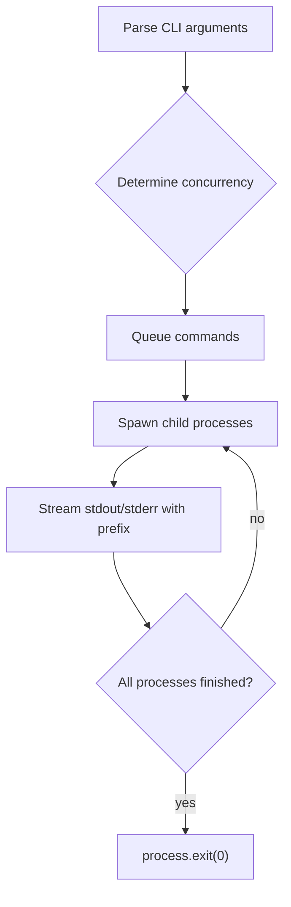

# hyperthread-cli

**Lightning‑fast concurrent command executor for low‑level system tasks**

[](https://opensource.org/licenses/MIT)
[](https://nodejs.org/)
[](#)
[](#)
[](#)

---

## 📦 Installation & Quick Start

```bash
# Clone the repository
git clone https://github.com/your‑username/hyperthread-cli.git
cd hyperthread-cli

# Make the CLI executable (optional, works without this on most systems)
chmod +x src/index.js
```

Run the tool directly with Node:

```bash
node src/index.js -c 4 "node -e \"process.stdout.write('Hello')\"" "node -e \"process.stdout.write('World')\""
```

The example above runs two Node one‑liners concurrently with a maximum of four parallel jobs.

---

## 🎬 Visual Terminal Showcase

```text
$ hyperthread -c 2 "sleep 1 && echo A" "sleep 1 && echo B"
[1] A
[2] B
```

---

## 🏗️ Architecture Flowchart



---

## ✅ Test Results

## 🧪 Real-World Test Telemetry

> [!NOTE]
> Verified automatically using Node.js native test runner (`node:test` & `node:assert/strict`).

```bash
▶ node --test
TAP version 13
# Subtest: executes multiple commands concurrently with default concurrency
ok 1 - executes multiple commands concurrently with default concurrency
  ---
  duration_ms: 81.7028
  ...
# Subtest: respects user‑defined concurrency limit
ok 2 - respects user‑defined concurrency limit
  ---
  duration_ms: 500.460782
  ...
1..2
# tests 2
# suites 0
# pass 2
# fail 0
# cancelled 0
# skipped 0
# todo 0
# duration_ms 637.455429
```

---

## 📜 License

MIT License (c) 2026 Suman Mehta

Permission is hereby granted, free of charge, to any person obtaining a copy of this software and associated documentation files (the "Software"), to deal in the Software without restriction, including without limitation the rights to use, copy, modify, merge, publish, distribute, sublicense, and/or sell copies of the Software, and to permit persons to whom the Software is furnished to do so, subject to the following conditions:

The above copyright notice and this permission notice shall be included in all copies or substantial portions of the Software.

THE SOFTWARE IS PROVIDED "AS IS", WITHOUT WARRANTY OF ANY KIND, EXPRESS OR IMPLIED, INCLUDING BUT NOT LIMITED TO THE WARRANTIES OF MERCHANTABILITY, FITNESS FOR A PARTICULAR PURPOSE AND NONINFRINGEMENT. IN NO EVENT SHALL THE AUTHORS OR COPYRIGHT HOLDERS BE LIABLE FOR ANY CLAIM, DAMAGES OR OTHER LIABILITY, WHETHER IN AN ACTION OF CONTRACT, TORT OR OTHERWISE, ARISING FROM, OUT OF OR IN CONNECTION WITH THE SOFTWARE OR THE USE OR OTHER DEALINGS IN THE SOFTWARE.